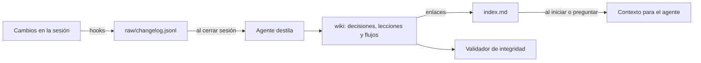

# Memex de decisiones

Memoria por proyecto para agentes de programación. Registra lo que cambia, lo convierte en decisiones y lecciones enlazadas, y se las recuerda al agente antes de que repita un error.

Funciona con [Claude Code](https://claude.com/claude-code), mediante hooks en Python sin dependencias externas.

## El problema

Un agente empieza cada sesión sin recordar por qué se tomó una decisión. Vuelve a discutir lo ya resuelto, repite errores corregidos y el contexto queda perdido en conversaciones viejas.

Las notas manuales ayudan, pero casi nunca se mantienen al día. Este sistema captura el trabajo por sí solo y deja al agente la tarea de organizarlo.

## Cómo funciona



1. **Captura:** los hooks registran los cambios relevantes en `raw/changelog.jsonl`, un archivo de solo agregar.
2. **Destilado:** al cerrar la sesión, si hay eventos pendientes, el agente los convierte en páginas de la wiki.
3. **Conexión:** cada página debe enlazar con otra. Una página sin enlaces salientes es un error crítico.
4. **Recuperación:** al iniciar la sesión y al recibir un mensaje, los hooks cargan las decisiones y lecciones relevantes.
5. **Validación:** `memex_lint.py` detecta enlaces rotos, páginas huérfanas, campos faltantes y un índice desincronizado.

## Pruébalo

Necesitas Python 3.8 o superior. El repositorio incluye un proyecto ficticio, **Ruta Verde**, en [`ejemplo/`](ejemplo/.memex/index.md).

```bash
git clone https://github.com/juansebastianvelez/memex-decisiones.git
cd memex-decisiones

# Valida la wiki de ejemplo
python3 hooks/memex_lint.py ejemplo

# Ejecuta las pruebas
python3 hooks/tests/test_memex.py
```

## Instalación

Primero revisa lo que hará el instalador:

```bash
python3 install.py --dry-run
```

Luego instala:

```bash
python3 install.py
```

El instalador copia los hooks y comandos en `~/.claude/`, crea una copia de seguridad de `settings.json`, conserva tus hooks actuales y no duplica los suyos. En proyectos sin `.memex/`, los hooks no hacen nada.

Para activarlo en un proyecto, abre Claude Code y ejecuta `/memex-init`. Para quitarlo: `python3 uninstall.py`.

## Comandos

| Comando | Qué hace |
|---|---|
| `/memex-init` | Crea `.memex/` en el proyecto |
| `/registrar-decision` | Registra una decisión en el momento |
| `/consultar-historial` | Busca qué se decidió antes sobre un tema |
| `/destilar` | Convierte a mitad de sesión los eventos pendientes en páginas |
| `/lint-memex` | Revisa la salud del grafo |

## Decisiones técnicas

- **Solo biblioteca estándar:** funciona sin paquetes externos. PyYAML es opcional y activa una validación más estricta del frontmatter.
- **Código para lo mecánico, modelo para el criterio:** los hooks capturan y validan de forma determinista; el agente interpreta y redacta.
- **Registro crudo inmutable:** cada afirmación de la wiki puede rastrearse hasta su evento de origen.
- **Instalación segura:** se puede ejecutar varias veces y siempre respalda la configuración.
- **Inactivo por defecto:** solo actúa donde existe `.memex/`.

## Estructura

```text
hooks/      Captura, biblioteca común, validador y pruebas
commands/   Comandos de Claude Code
ejemplo/    Proyecto ficticio con su wiki
install.py  Instalador
```

## Créditos

La organización en capas (fuentes crudas, wiki mantenida por el modelo, índice y registro) se inspira en el patrón [LLM Wiki de Andrej Karpathy](https://gist.github.com/karpathy/442a6bf555914893e9891c11519de94f). La implementación de los hooks, la captura automática, el validador y el instalador son propios.

## Licencia

[MIT](LICENSE)
